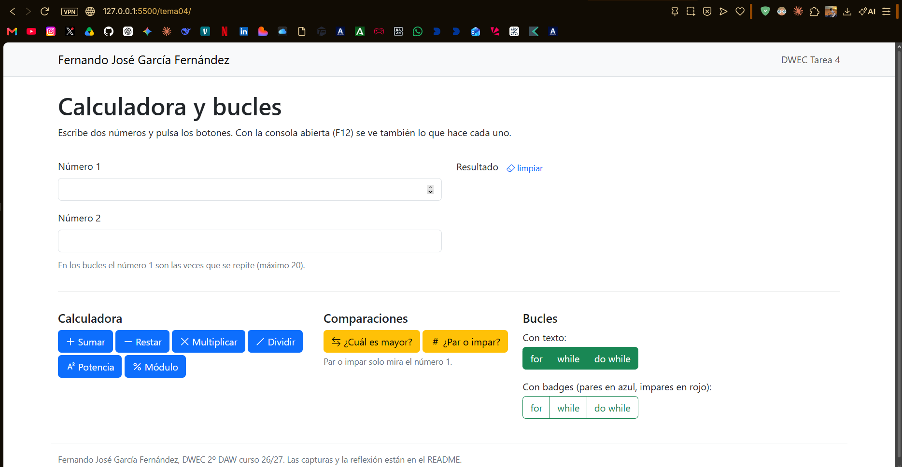
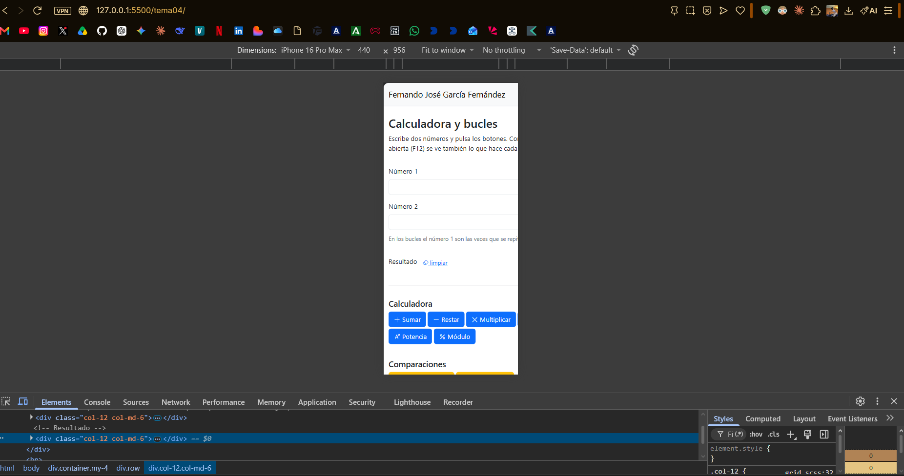
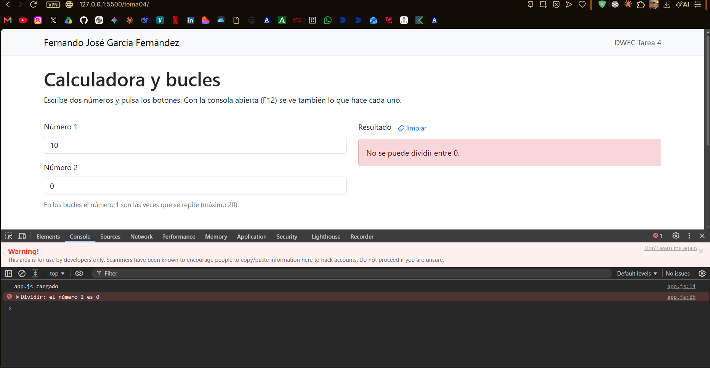
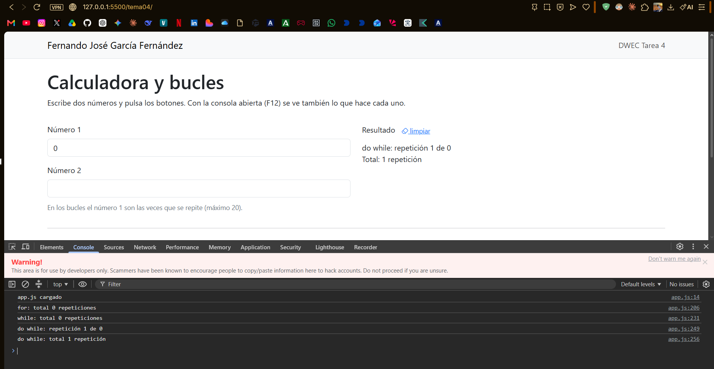
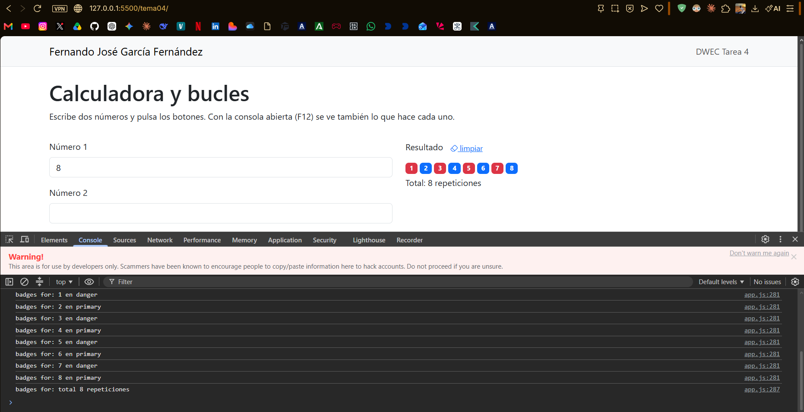

# Tarea 4 Calculadora y bucles

**Alumno:** Fernando José García Fernández

**Módulo:** Desarrollo Web en Entorno Cliente, 2º DAW, curso 2026/27

En esta carpeta está la página de la calculadora y los bucles. Para probarla abro la carpeta en VS Code, le doy a Go Live, escribo los números y pulso los botones con la consola abierta (F12).

## Capturas

**1. La página entera**

Mi nombre sale arriba en la barra y abajo en el pie. Arriba están los números y el resultado, y debajo de la línea los tres ejercicios en columnas.

**2. La página en el móvil**

En el móvil todas las cards se ponen una debajo de otra porque usan col-12.

**3. Dividir entre 0**

Con el número 2 a 0 sale el aviso en rojo y en la consola el error, en vez de salir Infinity.

**4. Los tres bucles con 0**

Con 0 el for y el while no hacen ninguna vuelta, pero el do while hace una.

**5. Bucle con badges**

He puesto el número [X]. Los pares salen en azul y los impares en rojo, el color lo saco con el ternario.

## Reflexión

Los tres bucles repiten código pero cambia cuándo comprueban la condición. El for lo uso cuando sé cuántas vueltas va a dar, porque el contador, la condición y el i++ van en la misma línea. El while comprueba la condición antes de entrar, así que lo usaría cuando no sé cuántas vueltas va a dar. El do while primero hace la vuelta y después comprueba, por eso siempre entra una vez. Esto lo vi probando con el 0: el for y el while miran si 1 <= 0, como es falso no hacen nada, pero el do while escribe la primera línea antes de comprobarlo. Con un negativo pasa lo mismo.

## Fuentes

- [MDN: Bucles e iteración](https://developer.mozilla.org/es/docs/Web/JavaScript/Guide/Loops_and_iteration)
- [MDN: Operador condicional (ternario)](https://developer.mozilla.org/es/docs/Web/JavaScript/Reference/Operators/Conditional_operator)
- [MDN: Resto (%)](https://developer.mozilla.org/es/docs/Web/JavaScript/Reference/Operators/Remainder)
- [Documentación de Bootstrap 5.3](https://getbootstrap.com/docs/5.3/)

## Uso de IA

He usado Claude para que me guiara con los pasos de la tarea y me diera una base del código y de la maquetación. Después lo he cambiado a mi gusto, lo he probado con varios números y la consola abierta y me he asegurado de entender cada función para la defensa.
