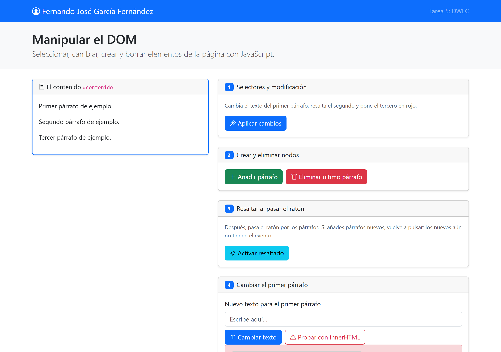
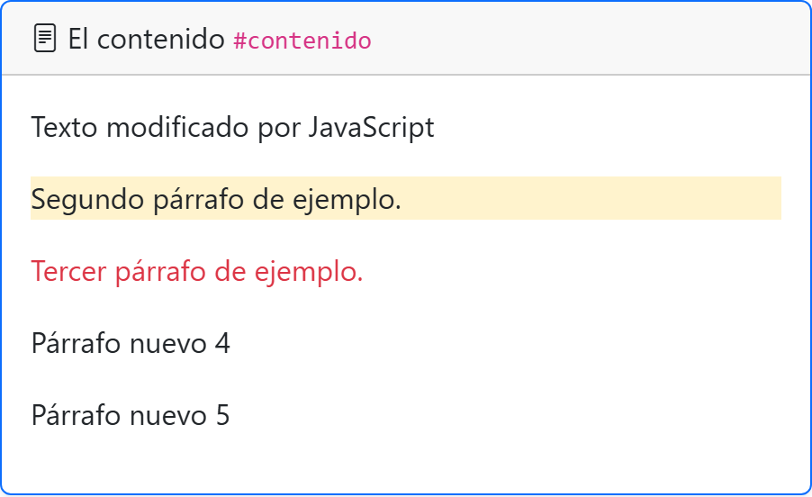
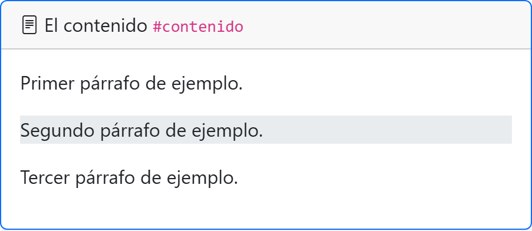
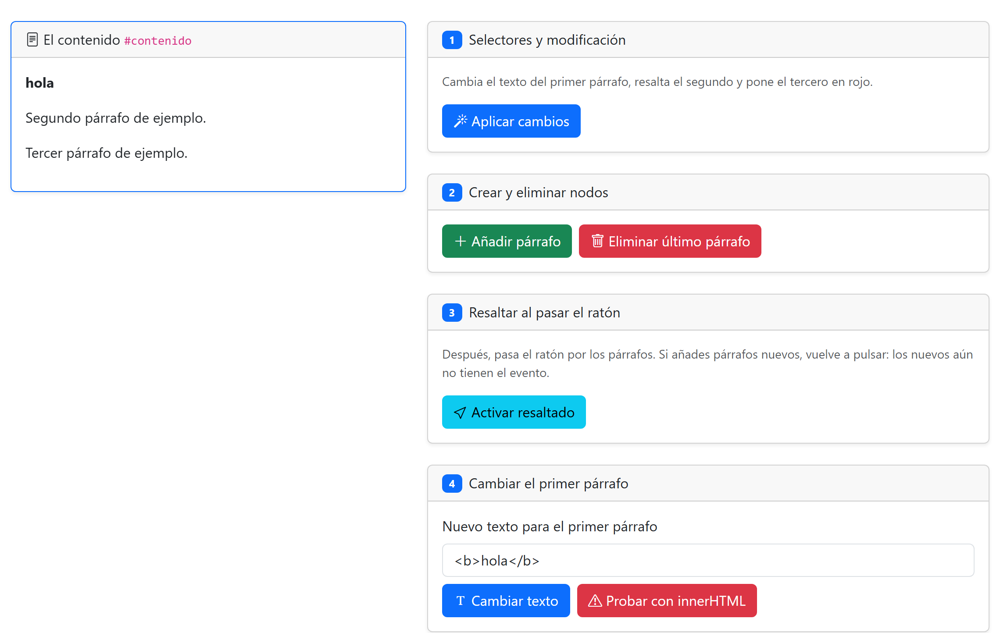
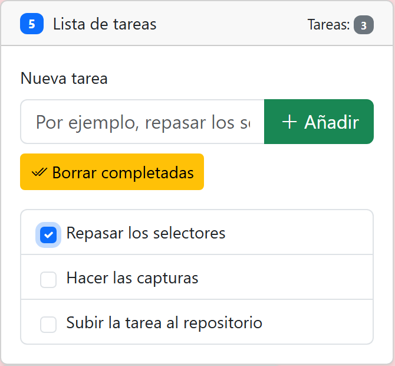
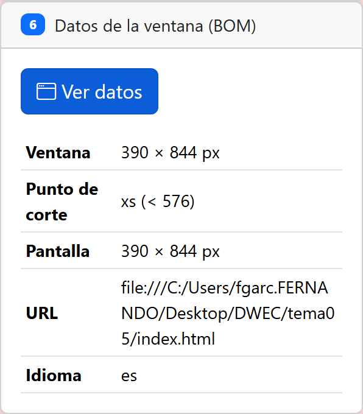

# Tarea 5: Manipular el DOM

**Autor:** Fernando José García Fernández. DWEC, 2.º DAW, curso 2026-27.

En esta carpeta está `index.html` (la página ya maquetada con Bootstrap que se manipula) y `js/app.js` (el JavaScript que selecciona, cambia, crea y borra elementos). Para probarlo abro la carpeta en VS Code, le doy a Go Live y uso los botones con la consola abierta (F12), donde cada acción deja su mensaje con `console.log()`.

## Capturas

### a) La página recién cargada

Se ve mi nombre en la barra de navegación y, en la tarjeta `#contenido`, los tres párrafos de partida sin tocar.

### b) Ejercicios 1 y 2

Después de pulsar "Aplicar cambios": el primer párrafo cambia de texto (lo cojo por su `id` con `getElementById`), el segundo se queda amarillo (por su clase `.segundo` con `querySelector`) y el tercero en rojo (por su posición con `querySelectorAll("#contenido p")[2]`). Debajo, dos párrafos que he añadido con "Añadir párrafo" ("Párrafo nuevo 4" y "Párrafo nuevo 5").

### c) Ejercicio 3: resaltado al pasar el ratón

Con el ratón encima, el párrafo se resalta (clase `bg-body-secondary`) y vuelve a lo normal al salir. Los párrafos que añada después de darle a "Activar resaltado" todavía no tienen el evento: hay que volver a pulsar el botón para que también respondan.

### d) Ejercicio 4: innerHTML con `<b>hola</b>`

Escribiendo `<b>hola</b>` en el campo: con "Cambiar texto" (`textContent`) se ve tal cual el texto `<b>hola</b>` con las etiquetas; con "Probar con innerHTML" el navegador interpreta el HTML y se ve **hola** en negrita.

### e) Ejercicio 5: la lista de tareas

Tres tareas añadidas, con una marcada, justo antes de darle a "Borrar completadas". El contador `#totalTareas` pone 3.

### f) Ejercicio 6: los datos de la ventana en el móvil

En la vista móvil (ventana estrecha) el punto de corte que sale es xs (menos de 576 px). En mi ordenador, con la ventana ancha, sale xl o xxl según el tamaño. También muestra el tamaño de la ventana, el de la pantalla, la URL y el idioma del navegador.

## Reflexión

`textContent` trata todo lo que le paso como texto normal: si le paso `<b>hola</b>`, en la página se ve literalmente `<b>hola</b>` con las etiquetas. `innerHTML` en cambio interpreta eso como HTML: con `<b>hola</b>` el navegador crea un elemento `<b>` de verdad y se ve **hola** en negrita. Por eso `innerHTML` va bien cuando el contenido lo controlo yo, pero es peligroso con lo que escribe el usuario: si meto en `innerHTML` algo que teclea otra persona, podría colar etiquetas como `<script>` y ejecutar código en la página (un ataque XSS). Con `textContent` eso no pasa, porque nunca se interpreta como HTML, solo se enseña como texto. Por eso para lo que escribe el usuario uso siempre `textContent`, y dejo `innerHTML` solo para HTML que pongo yo y del que me fío.

## Fuentes

- [Document.querySelector() en MDN](https://developer.mozilla.org/es/docs/Web/API/Document/querySelector)
- [Node.textContent en MDN](https://developer.mozilla.org/es/docs/Web/API/Node/textContent)
- [Element.innerHTML en MDN](https://developer.mozilla.org/es/docs/Web/API/Element/innerHTML)
- [Breakpoints de Bootstrap 5.3](https://getbootstrap.com/docs/5.3/layout/breakpoints/)

## Uso de IA

He usado una herramienta de IA (Claude) como apoyo: para repasar cómo funcionan los métodos del DOM del tema (querySelector, classList, createElement, innerHTML, el BOM) y para aclararme dudas y revisar la redacción del README. Después he ido probando cada función en el navegador con la consola abierta (F12) para ver qué hace y comprobar que cumple lo que pide el enunciado, y he subido el trabajo en varios commits a medida que avanzaba.
