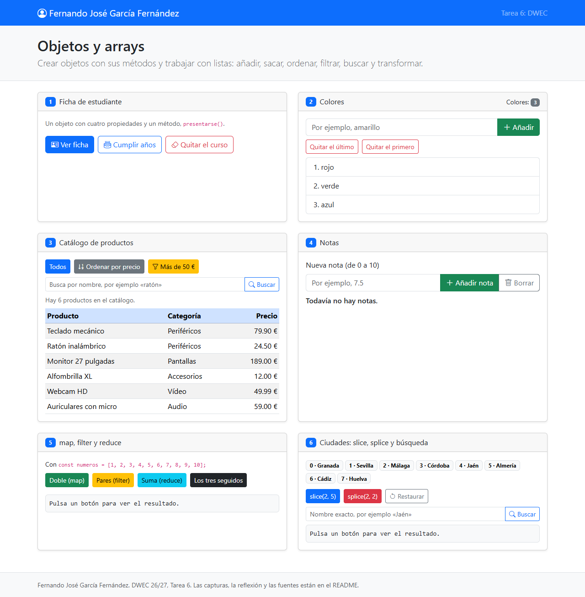
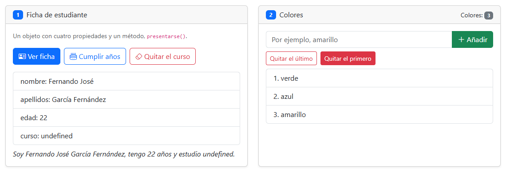
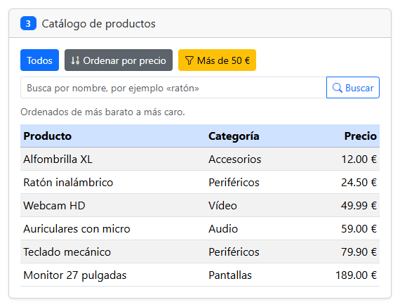
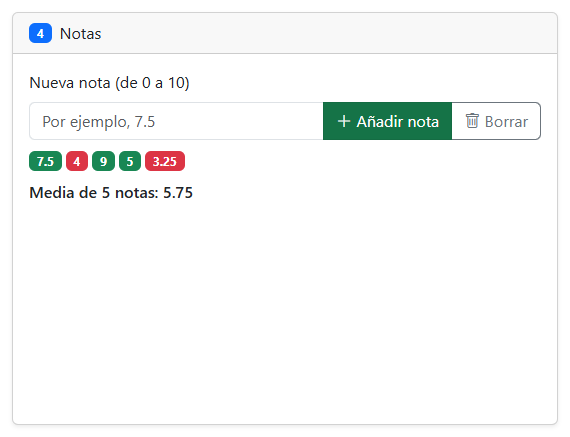
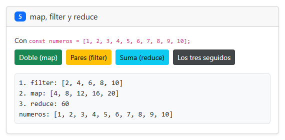
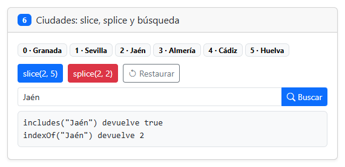

# Tarea 6: Objetos y arrays

**Autor:** Fernando José García Fernández. DWEC, 2.º DAW, curso 2026-27.

Aquí está `index.html` (la página) y `js/app.js` (los datos y una función por botón). Para probarlo abro la carpeta en VS Code, le doy a Go Live y uso los botones con la consola abierta (F12).

## Capturas

### a) La página recién cargada

Se ve mi nombre en la navbar, los tres colores, los seis productos y las ocho ciudades con su posición.

### b) Ejercicios 1 y 2: la ficha y los colores

La edad ha subido a 22. Al borrar el curso con `delete` sale `curso: undefined`, también en la frase, porque leer una propiedad que ya no existe da `undefined`. En los colores he añadido dos con `push` y he quitado uno con `pop` y otro con `shift`.

### c) Ejercicio 3: el catálogo ordenado por precio

Mi función de comparación devuelve `a.precio - b.precio`: si sale negativo, `a` va antes que `b`. Ordeno una copia porque `sort` cambia el array sobre el que se usa.

### d) Ejercicio 4: las notas y la media

Cinco notas, en verde las de 5 o más y en rojo las demás. La media sale 5.75.

### e) Ejercicio 5: los tres métodos seguidos

`filter` se queda con los pares, `map` calcula sus dobles y `reduce` los suma. Al final sale 60 y `numeros` sigue igual.

### f) Ejercicio 6: después de splice y de buscar una ciudad

`splice(2, 2)` ha quitado Málaga y Córdoba. Jaén estaba en la posición 4 y ahora `indexOf` da 2, porque las ciudades de detrás se mueven para ocupar el hueco.

## Reflexión

`push`, `pop`, `shift`, `splice` y `sort` cambian el array original, mientras que `slice`, `map` y `filter` devuelven uno nuevo y no lo tocan. `find`, `reduce`, `includes` e `indexOf` tampoco lo cambian, pero devuelven un solo valor. En el ejercicio 6 se ve claro: `slice(2, 5)` devuelve Málaga, Córdoba y Jaén y siguen quedando 8 ciudades, pero `splice(2, 2)` quita Málaga y Córdoba del propio array y se queda con 6. En el ejercicio 3 ordeno una copia porque, si usara `sort` directamente sobre `productos`, perdería el orden de partida y el botón "Todos" ya no enseñaría el catálogo como estaba.

## Fuentes

- [Array.prototype.sort() en MDN](https://developer.mozilla.org/es/docs/Web/JavaScript/Reference/Global_Objects/Array/sort)
- [Array.prototype.reduce() en MDN](https://developer.mozilla.org/es/docs/Web/JavaScript/Reference/Global_Objects/Array/reduce)
- [Array.prototype.splice() en MDN](https://developer.mozilla.org/es/docs/Web/JavaScript/Reference/Global_Objects/Array/splice)
- [Operador delete en MDN](https://developer.mozilla.org/es/docs/Web/JavaScript/Reference/Operators/delete)

## Uso de IA

He usado Claude (Claude Code) para hacer los ejercicios paso a paso, redactar este README y sacar las capturas en mi equipo con Opera GX. También he usado Gemini y alguna otra página para resolver dudas. Después he mirado los cambios de cada parte antes de hacer su commit y he subido el trabajo en varios commits.
