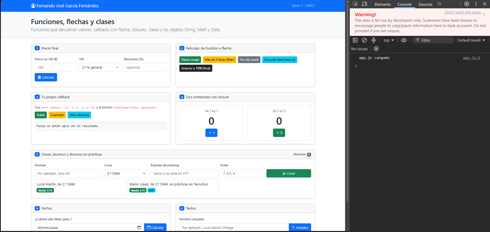
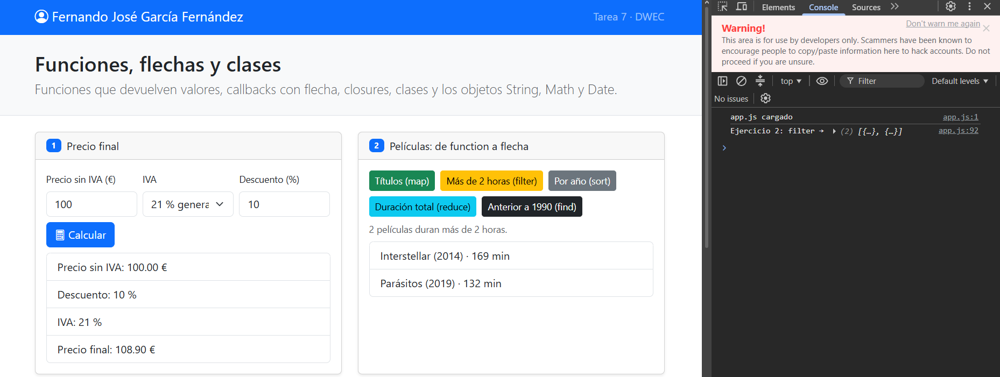
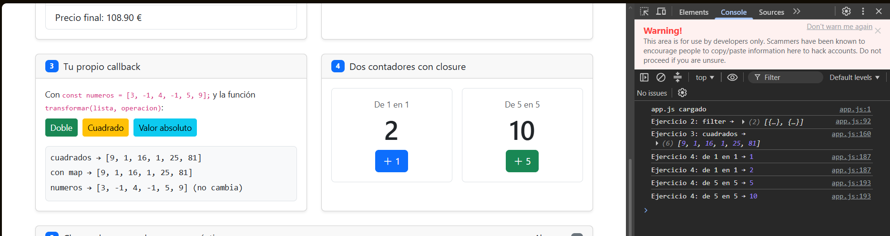
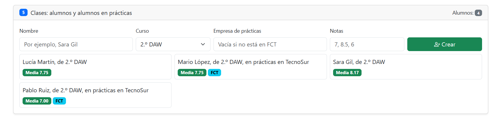
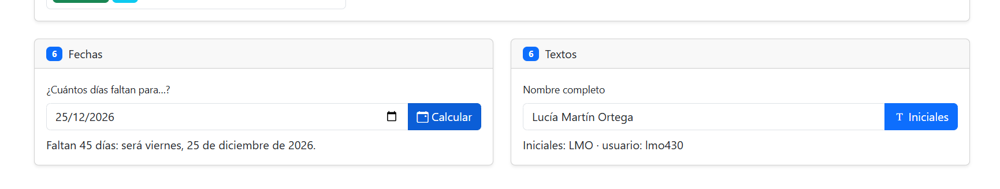

# Tarea 7: funciones, flechas y clases

Fernando José García Fernández · 2.º DAW · DWEC · Curso 2026-27

En esta carpeta está la página de la tarea. Se puede abrir `index.html` en el navegador o usar Go Live desde VS Code. Los botones permiten probar los ejercicios y ver los mensajes de la consola con F12.

## Capturas

### a) Página recién cargada

Al abrir la página aparecen mi nombre en la barra superior y los dos alumnos iniciales.

### b) Ejercicios 1 y 2: precio y películas

`calcularPrecio()` devuelve el precio con descuento e IVA. `mostrarPrecio()` lee los campos, comprueba los datos y muestra el desglose. En las películas uso `map`, `filter`, `sort`, `reduce` y `find` para obtener distintos resultados.

### c) Ejercicios 3 y 4: callback y contadores

`transformar()` recorre la lista, aplica la operación recibida y devuelve otra lista con los resultados. Cada contador conserva su propia variable `cuenta`, por eso avanzar uno no cambia el otro.

### d) Ejercicio 5: alumnos

El programa empieza con dos alumnos. Se pueden añadir más desde el formulario. Si se escribe una empresa, crea un `AlumnoFCT`; si se deja vacía, crea un `Alumno`.

### e) Ejercicio 6: fechas y textos

`diasHasta()` compara las fechas desde la medianoche y redondea el resultado, porque el cambio de hora puede dejar una diferencia que no sea un número entero de días. Para probarlo se puede elegir, por ejemplo, el 25 de diciembre de 2026.

## Reflexión

Al pasar un callback de `function` a flecha, una expresión de una sola línea puede devolver su resultado directamente. En `transformar()` uso `return` al final porque quiero devolver el array que he creado. Los métodos de clase los escribo como `media() { ... }`; no los hago flecha porque necesitan usar `this`. En el ejercicio 5, `media()` usa `reduce` con una flecha para sumar las notas. `AlumnoFCT` reutiliza la presentación del alumno con `super.presentarse()` y añade la empresa de prácticas.

## Fuentes

- [Funciones flecha en JavaScript, MDN](https://developer.mozilla.org/es/docs/Web/JavaScript/Reference/Functions/Arrow_functions)
- [Clases en JavaScript, MDN](https://developer.mozilla.org/es/docs/Web/JavaScript/Reference/Classes)
- [Array.prototype.find(), MDN](https://developer.mozilla.org/es/docs/Web/JavaScript/Reference/Global_Objects/Array/find)
- [Date.prototype.toLocaleDateString(), MDN](https://developer.mozilla.org/es/docs/Web/JavaScript/Reference/Global_Objects/Date/toLocaleDateString)

## Uso de IA

He usado ChatGPT para resolver dudas y revisar partes de la actividad. Después he comprobado el código y las explicaciones con las indicaciones de la plantilla.
