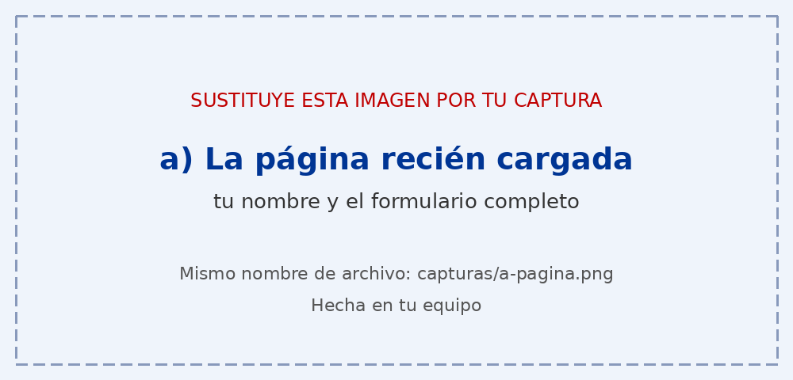
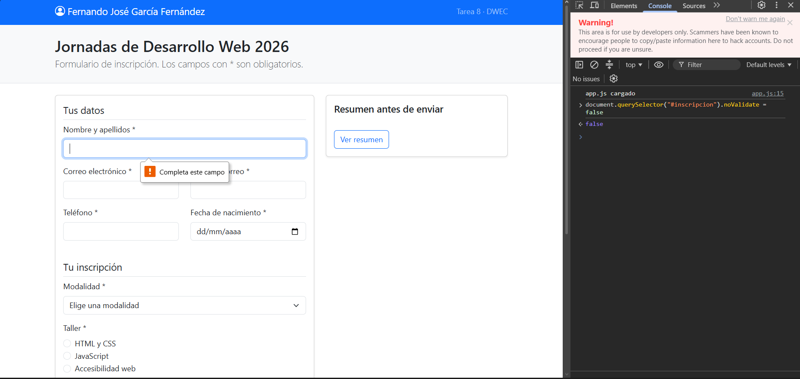
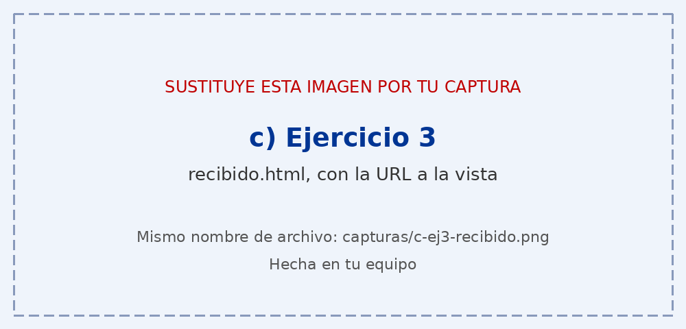
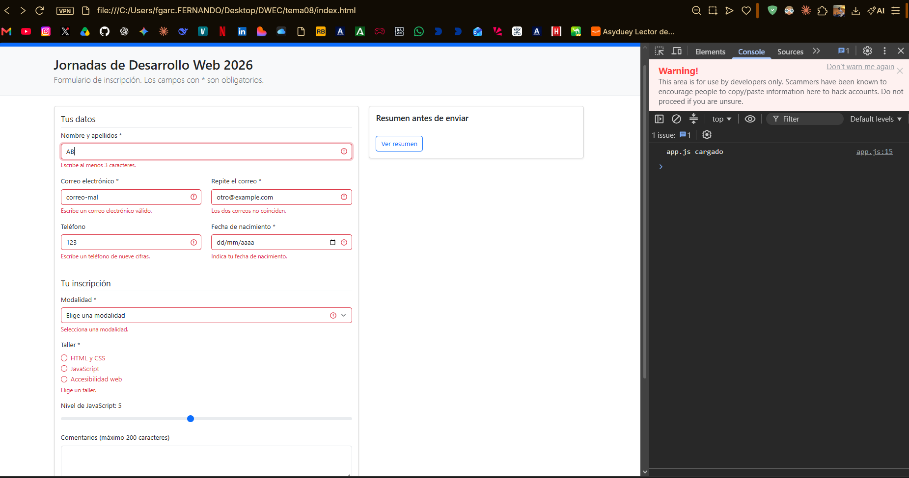
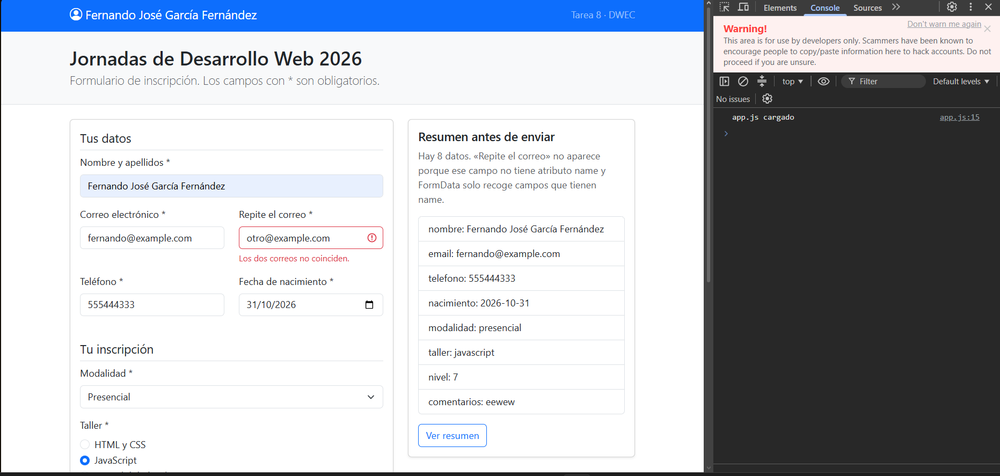

# Tarea 8 · Formulario de inscripción

**Autor:** Fernando José García Fernández · Desarrollo Web en Entorno Cliente (DWEC) · 2.º DAW · Curso 2026-27

En esta práctica he creado un formulario para inscribirse en unas jornadas de desarrollo web. Tiene campos personales, opciones de inscripción, validación con HTML y JavaScript, y una página que muestra los datos enviados por GET. Para abrirlo, se puede abrir la carpeta en Visual Studio Code y usar **Go Live**; la consola del navegador está en F12.

## Capturas

### a) La página recién cargada

Se ve el formulario vacío, mi nombre en la barra superior y los dos grupos de datos.

### b) Ejercicio 2: el mensaje del navegador

Al dejar un campo obligatorio vacío, el navegador impide el envío y muestra su mensaje. Si quito `required` desde las herramientas de desarrollo, puedo saltarme esa comprobación del navegador. Por eso la validación del servidor también es necesaria.

### c) Ejercicio 3: lo que llega por GET

En la URL se ven los nombres y valores de los campos enviados por GET, y la página los muestra en una tabla. «Repite el correo» no llega porque no tiene atributo `name`. No enviaría contraseñas por GET porque quedan visibles en la URL y pueden guardarse en el historial.

### d) Ejercicio 4: los errores, junto a cada campo

La captura muestra errores distintos: un campo obligatorio vacío, un correo con formato incorrecto y dos correos que no coinciden. Los mensajes salen de las propiedades de validación del campo o del mensaje personalizado que se define con `setCustomValidity()`.

### e) Ejercicios 5 y 6: eventos y resumen

Se ve el contador de comentarios, el nivel elegido, el aviso cuando los correos no coinciden y el resumen de datos generado con `FormData`.

## Reflexión

Con JavaScript puedo dar mensajes más claros y comprobar cosas como que los dos correos coincidan. La validación del navegador ayuda a corregir errores antes de enviar el formulario. Aun así, las comprobaciones del navegador se pueden modificar o saltar desde las herramientas de desarrollo. Por eso el servidor también debe revisar los datos que recibe. Cada lado cumple una función distinta para que los datos sean correctos. En un callback con una función flecha, `this` no apunta al formulario, así que uso `e.target`.

## Fuentes

- [Validación de formularios y Constraint Validation API (MDN)](https://developer.mozilla.org/es/docs/Web/HTML/Guides/Constraint_validation)
- [Validación de formularios (Bootstrap 5.3)](https://getbootstrap.com/docs/5.3/forms/validation/)

## Uso de IA

He usado ChatGPT y Claude para aclarar dudas y plantear algunas funciones de JavaScript. Después he revisado y adaptado las propuestas para hacer la práctica. También he consultado la documentación de MDN y Bootstrap.
